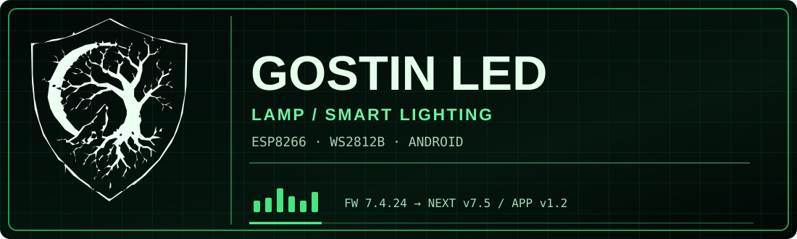
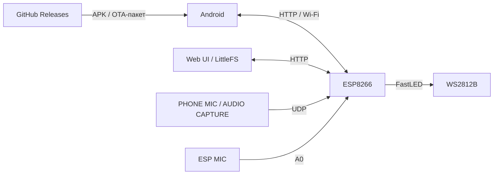

<div align="center">



# GOSTIN LED LAMP

**Розумне LED-освітлення • Світломузика • ESP8266 • Android • Web UI**

[](https://github.com/Gostin0/Led-Lamp/releases)
[](https://github.com/Gostin0/Led-Lamp/releases)
[](https://github.com/Gostin0/Led-Lamp)
[](https://github.com/Gostin0/Led-Lamp)

[**Завантаження**](https://github.com/Gostin0/Led-Lamp/releases) · [**Помилки та пропозиції**](https://github.com/Gostin0/Led-Lamp/issues)

</div>

---

## Про проєкт

**GOSTIN LED LAMP** — локально керована адресна лампа на ESP8266 та WS2812B. Працює як біле освітлення, декоративна лампа та світломузика. Керування доступне в браузері та через Android-додаток. Повсякденна робота не вимагає GitHub чи зовнішнього сервера.

> [!IMPORTANT]
> **Перевірена базова версія ESP:** `7.4.24-API-SPLIT`. **v7.5 (WEB SMART DEV1)** та **Android v1.2 (DEV1)** — тестова гілка. SMART LIGHT і будильники потребують перевірки на реальному обладнанні. Наявність коду не означає готовий стабільний реліз.

## Наявний функціонал

| Напрям | Можливості |
|---|---|
| Освітлення | ON/OFF (чорний кадр без зупинення мережі), біле світло, яскравість |
| LED | WS2812B, поточне налаштування 259 LED, конфігураційний ліміт до 600 |
| Ефекти | Декоративні ефекти, пошук, швидкість, профілі, параметри A/B/C, палітри та кольори |
| Звук | ESP MIC, PHONE MIC, AUDIO CAPTURE; VU, спектр, бас, ударні та інші музичні сцени |
| Передавання звуку | Аналіз на телефоні, UDP через Wi-Fi, резервне HTTP-передавання |
| Android | Головне керування, редактор ефектів, віджет, швидка плитка, системні налаштування |
| Web UI | Україномовні вкладки Лампа / Ефекти / Аудіо / Система, LittleFS |
| Обслуговування | Налаштування Wi-Fi, Recovery на порту 81, FS та OTA |
| Оновлення | GitHub Releases для APK, локальне OTA прошивки ESP та шести вебфайлів |

**SHOW Studio й XM Player вилучені.** AUDIO CAPTURE залежить від дозволів Android та обмежень застосунку-джерела звуку.

### SMART LIGHT — тестова гілка v7.5

У вихідному коді DEV1 є екран SMART LIGHT, окремі вечірній/нічний режими, акустична реакція, таймер тиші, NTP/час з Android, координати й чотири світлові будильники з плавним наростанням. Ці можливості **ще не позначаються як перевірені на фізичній лампі**.

## Архітектура



## Завантаження та оновлення

Файли публікуються в [**Releases**](https://github.com/Gostin0/Led-Lamp/releases), а не в основному дереві вихідного коду.

| Назва файлу | Призначення |
|---|---|
| `LED-Lampa.apk` | Android APK |
| `esp-release.zip` | `firmware.bin`, `manifest.json` та 6 вебфайлів |
| `SHA256SUMS.txt` | SHA-256 контрольні суми |

**Сумісність Android updater:** для автоматичної перевірки потрібна точна назва `LED-Lampa.apk`, стабільний GitHub Release із тегом `v1.2.0` (або наступним), та **такий самий `versionName` усередині APK**. `versionCode` має бути більшим за попередній; ключ підпису — тим самим.

<details>
<summary><b>Склад OTA-пакета</b></summary>

```text
esp-release.zip
├── firmware.bin
├── manifest.json
├── web/
│   ├── index.html
│   ├── app.js
│   └── style.css
└── wifi_setup/
    ├── index.html
    ├── app.js
    └── style.css
```

Не вимикай живлення ESP8266 під час OTA. Перед оновленням необхідно перевірити Flash, вільний простір і зробити резервну копію конфігурації.

</details>

## Швидкий старт

1. Завантаж сумісний APK із [Releases](https://github.com/Gostin0/Led-Lamp/releases).
2. Налаштуй домашній Wi-Fi через `LED_LAMP`, якщо мережа ще не задана.
3. Відкрий Android-додаток або локальний Web UI, вибери ефект і налаштуй звук.

---

<div align="center">

**GOSTIN LED LAMP — LIGHT · MUSIC · AUTOMATION**

</div>
