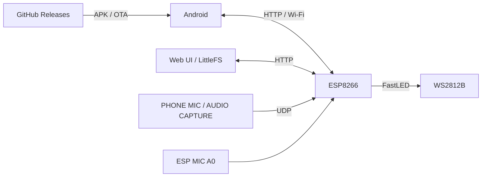

<div align="center">


# GOSTIN LED LAMP

**Розумне LED-освітлення • Світломузика • ESP8266 • Android • Web UI**

[](https://github.com/Gostin0/Led-Lamp/releases)
[](https://github.com/Gostin0/Led-Lamp/releases)
[](https://github.com/Gostin0/Led-Lamp)
[](https://github.com/Gostin0/Led-Lamp)

[**⬇️ Завантаження**](https://github.com/Gostin0/Led-Lamp/releases) · [**📝 Історія змін**](CHANGELOG.md) · [**🐞 Помилки та пропозиції**](https://github.com/Gostin0/Led-Lamp/issues)

</div>

---

## Про проєкт

**GOSTIN LED LAMP** — система локального керування адресним освітленням на базі **ESP8266 + WS2812B**. Працює як повсякденна біла лампа, декоративне освітлення та світломузика. Керування доступне з українського Web UI й Android-застосунку; повсякденна робота не потребує зовнішнього сервера.

### Актуальний комплект

| Компонент | Версія |
|---|---|
| ESP8266 firmware | **7.5.15** |
| Android | **1.3.0** (`versionCode 1306`) |
| Web UI | Комплект від firmware 7.5.15 |
| Оновлення | [GitHub Releases](https://github.com/Gostin0/Led-Lamp/releases) |

> [!IMPORTANT]
> Версія **7.5.15 / 1.3.0** підготовлена та опублікована як комплект оновлення. Роботу будильника було підтверджено на попередній тестовій збірці, але повні апаратні перевірки **нових годин тиші, колірної температури, OTA та тривалої стабільності ESP8266** ще не підтверджені. Не плутай статус публікації зі статусом повного тестування. Раніше перевірена базова ESP: `7.4.24-API-SPLIT`.

## SMART LIGHT — автоматичне освітлення

- **Активація за звуком:** мікрофон ESP8266 на A0 запускає освітлення ввечері та вночі.
- **Вечір / ніч:** незалежні перемикачі, яскравість і температура білого **1800–6500 K**.
- **Час доби:** налаштування геолокації, розрахунок сходу/заходу сонця, місцевий час та DST.
- **SMART ANIMATION:** іскорки рухаються до основи; світло заповнює стрічку до вершини.
- **Автоматичне згасання:** протягом останніх 60 секунд світло згасає згори вниз, останні іскорки розлітаються.
- **SMART REWIND:** повторний звук під час згасання плавно повертає анімацію з поточного положення.
- **Таймер тиші:** новий звук поновлює таймер, доки активний поточний цикл.
- **Години тиші:** заданий проміжок блокує **тільки нову звукову активацію з повного OFF**. Якщо лампа вже працює, звук продовжує її таймер і реверс аж до повного згасання.
- **Ручний OFF:** тимчасове блокування звукової автоматики.

### Світлові будильники

Чотири незалежні будильники: час, дні тижня, тривалість, плавне наростання яскравості та **власна колірна температура**. Будильники не блокуються «Годинами тиші» або паузою після ручного OFF. Сервісну кнопку перевірки збереженого будильника видалено з інтерфейсу.

## Інші можливості

| Напрям | Можливості |
|---|---|
| Освітлення | ON/OFF через чорний LED-кадр без зупинення мережі, White Light, яскравість |
| LED | WS2812B, конфігураційний діапазон 10–600 LED; приклад установки — 259 LED |
| Ефекти | Декоративні ефекти, пошук, швидкість, профілі, параметри A/B/C, кольори та палітри |
| Аудіо | ESP MIC, PHONE MIC, AUDIO CAPTURE, VU/спектр/музичні сцени |
| Зв'язок | Аудіо з телефона через UDP по Wi-Fi, резервний HTTP |
| Android | Ефекти, керування лампою, SMART LIGHT, віджет, швидка плитка та системні налаштування |
| Web UI | Українська локалізація, налаштування SMART LIGHT, LittleFS |
| Обслуговування | Wi-Fi, Recovery на порту 81, файловий менеджер, OTA |

**SHOW Studio та XM Player вилучені.** AUDIO CAPTURE залежить від дозволів Android та обмежень джерела звуку.

## Завантаження й оновлення

Завантажуй файли з [**Releases**](https://github.com/Gostin0/Led-Lamp/releases), а не з автоматично сформованого GitHub Source code ZIP, якщо тобі потрібні готові APK та OTA.

| Файл у релізі | Для чого |
|---|---|
| `LED-Lampa.apk` | Підписаний інсталяційний Android-файл |
| `esp-release.zip` | `firmware.bin`, `manifest.json` та шість файлів Web UI |
| `SHA256SUMS.txt` | Контрольні SHA-256 для перевірки завантаження |

> [!NOTE]
> Для Android-оновлення з 1.2.x до **1.3.0** потрібен APK із `versionName=1.3.0`, більшим `versionCode` та **тим самим ключем підпису**, що в попередньому застосунку. Механізм перевірки нової версії використовує назву `LED-Lampa.apk` та GitHub Releases; фактичний тег і файли релізу мають відповідати APK. Перед встановленням зроби резервну копію налаштувань.

<details>
<summary><b>Структура OTA-пакета</b></summary>

```text
esp-release.zip
├── firmware.bin
├── manifest.json
├── web/
│   ├── index.html
│   ├── app.js
│   └── style.css
└── wifi_setup/
    ├── index.html
    ├── app.js
    └── style.css
```

Не відключай ESP8266 від живлення під час OTA. Спершу перевір доступну Flash-пам'ять, Recovery й сумісність архіву з платою.

</details>

## Швидкий старт

1. Завантаж `LED-Lampa.apk` з [Releases](https://github.com/Gostin0/Led-Lamp/releases).
2. Якщо мережу не налаштовано, підключися до точки доступу `LED_LAMP` та налаштуй домашній Wi-Fi.
3. Відкрий Android або локальний Web UI, підключи пристрій, налаштуй ефекти та SMART LIGHT.
4. Для оновлення прошивки використовуй сумісний `esp-release.zip`; перед OTA зроби резервну копію конфігурації.

## Архітектура



---

<div align="center">

**GOSTIN LED LAMP — LIGHT · MUSIC · AUTOMATION**

</div>
