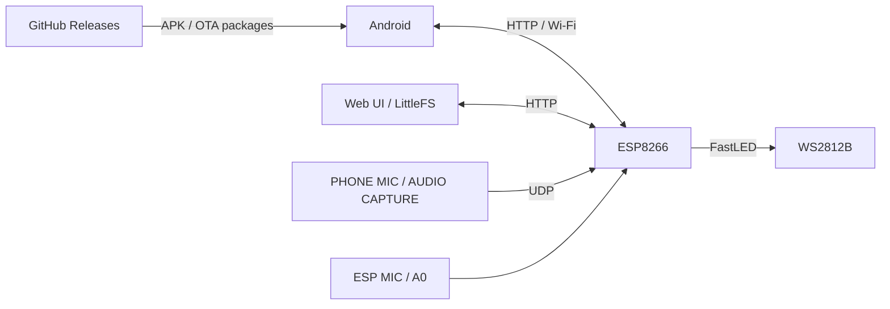

# GOSTIN LED LAMP

**LIGHT · MUSIC · AUTOMATION**

Розумне освітлення на **ESP8266 + WS2812B** з Android-застосунком, локальним Web UI та світломузикою.

[**⬇ Завантажити актуальну версію**](https://github.com/Gostin0/Led-Lamp/releases/tag/1.4.6) · [**📝 Історія змін**](CHANGELOG.md) · [**🐞 Повідомити про проблему**](https://github.com/Gostin0/Led-Lamp/issues)

---

## Про проєкт

**GOSTIN LED LAMP** — система локального керування адресною LED-стрічкою: біле освітлення, декоративні й аудіореактивні ефекти, автоматичне світло та будильники. У звичайному режимі працює локально через Wi-Fi, без хмарного сервера.

### Поточний офіційний реліз

| Компонент | Версія / статус |
|---|---|
| Прошивка ESP8266 | **7.5.18-BOOT-SCAN-RC1** |
| Android | **1.4.6** (`versionCode 1406`) |
| Web UI | Базовий Web із OTA-пакета v7.5.18 |
| Випуск | [GitHub Release `1.4.6`](https://github.com/Gostin0/Led-Lamp/releases/tag/1.4.6) |

> [!NOTE]
> **Forest Glass** — окремий експериментальний редизайн Web UI. Він **не входить** в офіційний OTA-комплект 1.4.6. Повне фізичне тестування OTA саме опублікованого комплекту не заявляється.

## Можливості

| Розділ | Що доступно |
|---|---|
| 💡 Освітлення | ON/OFF без зупинення Wi-Fi, режим **White Light**, яскравість, температура білого |
| 🎨 Ефекти | Декоративні й музичні анімації, швидкість, кольори та індивідуальні профілі |
| 🎵 Аудіо | Мікрофон ESP8266, PHONE MIC, AUDIO CAPTURE, передавання звуку через UDP |
| 🌙 SMART LIGHT | Вечірній/нічний режими, звукова активація, таймер тиші, анімація та реверс |
| ⏰ Будильники | До чотирьох світлових будильників із розкладом і плавним увімкненням |
| 📱 Android | Керування лампою, ефектами, звуком, SMART LIGHT, будильниками та системою |
| 🌐 Web UI | Український вебінтерфейс, параметри, LittleFS і Wi-Fi Setup |
| 🔧 Обслуговування | OTA, Recovery на порту **81**, налаштування мережі |

**Quick Settings Tile (Android 1.4.6):** плитка в шторці перемикає лампу; під час увімкнення вибирає **White Light**. Якщо лампа вже увімкнена, перше натискання її вимикає.

**Wi-Fi BOOT SCAN (ESP 7.5.18):** список до 12 мереж формується **один раз при запуску** ESP та читається Android і Wi-Fi Setup із кешу. Для оновлення списку перезавантаж ESP8266; натискання «Знайти Wi-Fi» не запускає нове радіосканування.

**Вилучені можливості:** SHOW Studio та XM Player не входять до поточного комплекту.

## Завантаження

Завантажуй інсталяційні файли **з Releases**, а не з автоматичного архіву вихідного коду GitHub.

| Файл | Призначення |
|---|---|
| [`LED-Lampa.apk`](https://github.com/Gostin0/Led-Lamp/releases/download/1.4.6/LED-Lampa.apk) | Підписаний Android v1.4.6 |
| [`esp-release.zip`](https://github.com/Gostin0/Led-Lamp/releases/download/1.4.6/esp-release.zip) | Firmware, OTA-маніфест і шість файлів Web/Wi-Fi Setup |
| [`SHA256SUMS.txt`](https://github.com/Gostin0/Led-Lamp/releases/download/1.4.6/SHA256SUMS.txt) | Контрольні SHA-256 |

> [!IMPORTANT]
> Перед оновленням ESP збережи налаштування, перевір доступ до Recovery та не вимикай живлення під час OTA. Для встановлення нового APK **поверх попереднього** потрібен той самий сертифікат підпису і вищий `versionCode`.

### Початок роботи

1. Встанови `LED-Lampa.apk` із поточного релізу.
2. Налаштуй Wi-Fi лампи (за потреби під’єднайся до точки доступу `LED_LAMP`).
3. Відкрий Android або локальний Web UI та налаштуй світло, ефекти й SMART LIGHT.
4. Для оновлення ESP використовуй сумісний OTA-пакет і засоби Recovery.

## Історія релізів

| Реліз | ESP8266 | Головна тема | Опис |
|---|---|---|---|
| [**Android 1.4.6**](https://github.com/Gostin0/Led-Lamp/releases/tag/1.4.6) | **7.5.18** | White Light у шторці, BOOT SCAN і зменшення навантаження | [Деталі](release-notes/1.4.6.md) |
| [Android 1.3.0](https://github.com/Gostin0/Led-Lamp/releases/tag/1.3.0) | 7.5.15 | SMART LIGHT, будильники, анімація | [Деталі](release-notes/1.3.0.md) |
| [Android 1.2.0](https://github.com/Gostin0/Led-Lamp/releases/tag/v1.2.0) | 7.5.0-WEB-DEV1 | Попередня тестова Web/Android інтеграція | [Деталі](release-notes/v1.2.0.md) |

У кожного релізу **свій історичний OTA-пакет**; не змішуй APK та `esp-release.zip` з різних версій.

Докладніше — [CHANGELOG.md](CHANGELOG.md). Архівний опис [Android 1.3.0](RELEASE_NOTES_v1.3.0.md).

## Архітектура

---

**GOSTIN LED LAMP — LIGHT · MUSIC · AUTOMATION**

