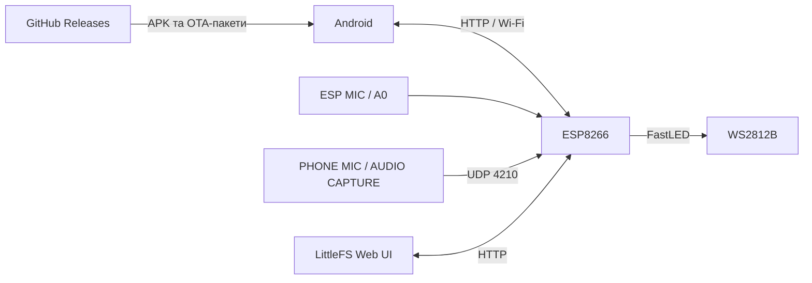

<div align="center">


# GOSTIN LED LAMP

**Розумне LED-освітлення • Світломузика • ESP8266 • Android • Web UI**

[](https://github.com/Gostin0/Led-Lamp)
[](https://github.com/Gostin0/Led-Lamp/releases)
[](https://github.com/Gostin0/Led-Lamp)
[](https://github.com/Gostin0/Led-Lamp)

[📦 **Релізи**](https://github.com/Gostin0/Led-Lamp/releases) · [🐛 **Помилки та пропозиції**](https://github.com/Gostin0/Led-Lamp/issues)

</div>

---

## 💚 Про проєкт

**GOSTIN LED LAMP** — система керування адресною LED-стрічкою **WS2812B** на **ESP8266**, створена для декоративного освітлення, білого світла та музичних ефектів. Лампа працює автономно, а керувати нею можна з **Android-додатка** або через **локальний вебінтерфейс**.

> [!IMPORTANT]
> **Перевірена вихідна база прошивки:** `7.4.24-API-SPLIT`. Наступна лінійка: **ESP8266 v7.5 / Android v1.2**. SMART LIGHT та будильники наразі у тестовій розробці, а не в штатній v7.4.24. Фактично доступні збірки дивіться у [Releases](https://github.com/Gostin0/Led-Lamp/releases).

## ✨ Можливості ESP8266

| Функція | Опис |
|---|---|
| 💡 **Біле світло** | Керування яскравістю, звичайне освітлення |
| ⏻ **ON/OFF** | Передавання чорного кадру без вимкнення Wi-Fi й сервісів |
| 🌈 **LED-ефекти** | Декоративні, динамічні, колірні та аудіореактивні сцени |
| 🎚️ **Профілі ефектів** | Швидкість, кольори, параметри A/B/C, індивідуальні налаштування |
| 🎨 **Палітри** | Редагування кольорів у підтримуваних ефектах |
| 🎼 **Музична візуалізація** | VU, спектр, бас, ударні, вокал та інші музичні сцени |
| 🔊 **3 джерела звуку** | ESP MIC / PHONE MIC / AUDIO CAPTURE |
| 🌙 **Реакція на тишу** | Пороги, затримка та демоефект при тиші |
| ⚡ **Вивід LED** | Віртуальна 12-бітна яскравість, згладжування та програмний ліміт струму |
| 📶 **Wi-Fi та Web UI** | Локальний HTTP API, LittleFS, налаштування мережі |
| 🛠️ **Recovery** | Сервіс відновлення на порту **81**, інструменти файлової системи |
| 🔄 **OTA** | Оновлення прошивки й файлів вебінтерфейсу |

Поточна конфігурація розрахована на **259 WS2812B**, буфер прошивки підтримує до **600 LED**. Реальна кількість задається конфігурацією.

## 📱 Android — GOSTIN LED

- **Лампа:** ON/OFF, біле світло, яскравість.
- **Ефекти:** каталог, вибір, пошук, швидкість та редактор профілів.
- **Аудіо:** **ESP MIC**, **PHONE MIC**, **AUDIO CAPTURE**, музичні режими та параметри звуку.
- **Система:** Wi-Fi, мережа, конфігурація, інформація про ESP8266.
- **Швидкий доступ:** віджет домашнього екрана та плитка в шторці Android.
- **Оновлення:** перевірка GitHub Releases, завантаження APK з підтвердженням інсталяції через Android, локальне OTA ESP.

**SHOW Studio та XM Player видалені** — застосунок зосереджено на світломузиці та стабільності.

> [!NOTE]
> AUDIO CAPTURE залежить від дозволів та обмежень Android: не всі програми дозволяють захоплення системного звуку.

## 🎵 Звідки надходить звук?

| Джерело | Передавання |
|---|---|
| **ESP MIC** | Вхід A0 на контролері ESP8266 |
| **PHONE MIC** | Аналіз мікрофона телефону й передавання до ESP |
| **AUDIO CAPTURE** | Аналіз дозволеного системного аудіопотоку Android |
| **PHONE AUDIO UDP** | Передавання аудіоданих через Wi-Fi, порт **4210**; резервний HTTP-кадр |

## 🌐 Архітектура



Звичайні ефекти рендеряться безпосередньо на ESP8266. **GitHub не потрібен для щоденної роботи лампи.**

## 🚀 Швидкий старт

1. Відкрийте [**GitHub Releases**](https://github.com/Gostin0/Led-Lamp/releases) і завантажте сумісну версію Android-додатка.
2. Під'єднайте лампу до правильно підібраного джерела живлення. Якщо домашню мережу ще не налаштовано, використайте точку доступу **`LED_LAMP`**.
3. Підключіть лампу до домашнього Wi-Fi через сторінку налаштувань.
4. Відкрийте Android-додаток або Web UI, виберіть ефект та джерело звуку.

> [!CAUTION]
> Забезпечте спільну землю ESP та LED-стрічки, відповідний блок живлення й захист проводки. Програмне обмеження струму не замінює електричного захисту.

## 📦 Оновлення через GitHub

Android і ESP8266 мають **незалежні номери версій**.

| Файл у Release | Призначення |
|---|---|
| `LED-Lampa.apk` | Android APK |
| `esp-release.zip` | Пакет `firmware.bin`, **6 Web-файлів** і `manifest.json` |

<details>
<summary><b>📂 Структура пакета для OTA</b></summary>

```text
esp-release.zip
├── firmware.bin
├── manifest.json
├── web/
│   ├── index.html
│   ├── style.css
│   └── app.js
└── wifi_setup/
    ├── index.html
    ├── style.css
    └── app.js
```

Перед OTA перевіряються сумісність, файли та контрольні суми. Не вимикайте живлення ESP під час прошивки. Оновлення LittleFS потребує збереження користувацьких налаштувань.

</details>

**Для публікації APK:** поточний Android updater очікує **саме `LED-Lampa.apk`** та тег формату **`v1.2.0`** (в APK `versionName = "1.2.0"`). У назві застосунку при цьому можна вказувати **v1.2**. Підписувати оновлення слід тим самим ключем, що і попередню версію; `versionCode` має зростати.

## 🌙 SMART LIGHT — наступний етап

> **У розробці / тестуванні.** Для цього потрібна нова сумісна прошивка ESP, бо базова v7.4.24 ще не має SMART LIGHT API.

- **Вечірній та нічний режими** — незалежні перемикачі й яскравість білого.
- **Акустична активація** — короткий звук вмикає освітлення, таймер тиші повертає попередній стан.
- **Геолокація Android** — координати для обчислення сутінків.
- **NTP / синхронізація з телефоном** — поточний час і часовий пояс.
- **4 світлові будильники** — різні години, дні тижня, яскравість, тривалість і плавне пробудження.
- **Пріоритет ручного керування** — ON/OFF чи зміна ефекту припиняє сценарій автоматики.

## ⚙️ Технології

`ESP8266` · `NodeMCU` · `Arduino C++` · `FastLED` · `WS2812B` · `LittleFS` · `Wi-Fi` · `HTTP API` · `UDP` · `Kotlin` · `Jetpack Compose` · `GitHub Releases`

---

<div align="center">

### 💚 GOSTIN LED LAMP
**LIGHT · MUSIC · AUTOMATION**

[⬆️ На початок](#gostin-led-lamp) · [📦 Релізи](https://github.com/Gostin0/Led-Lamp/releases) · [💬 Issues](https://github.com/Gostin0/Led-Lamp/issues)

</div>
